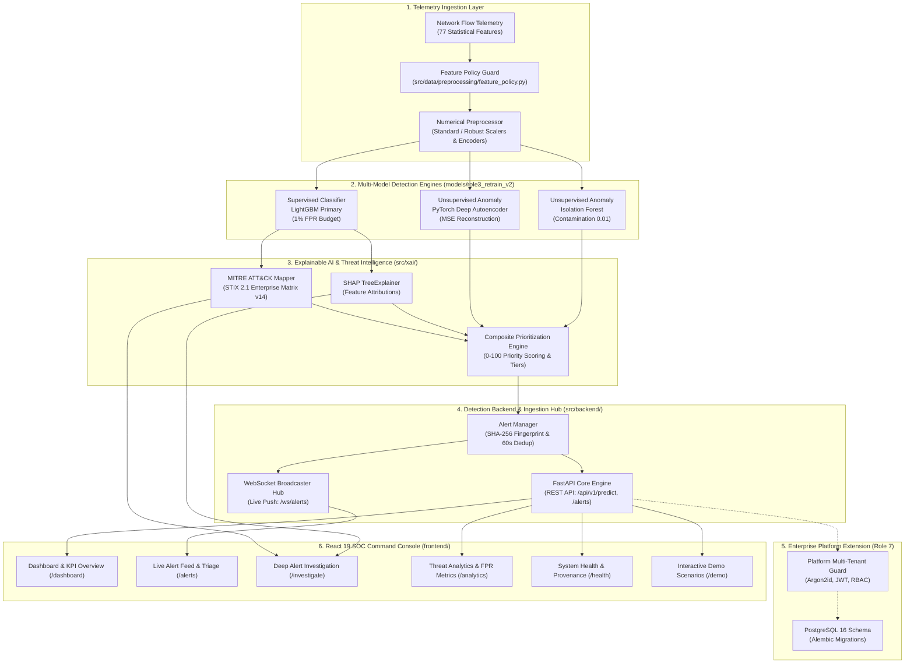

# AI/ML-Based Cyber Defense Platform: Team Neural Breach

[](https://www.python.org/)
[](https://react.dev/)
[](#8-automated-verification--testing)
[](#82-frozen-ml-model-artifact-integrity)
[-orange.svg)](#10-operating-invariants--security-governance)
[-red.svg)](#2-key-capabilities)

> **Autonomous Network Intrusion Detection, Dual-Engine Anomaly Scoring, Real-Time SHAP Explainability, MITRE ATT&CK Threat Intelligence & Interactive SOC Command Console.**

---

## 1. Project Introduction & Problem Statement

Modern enterprise Security Operations Centers (SOCs) face four critical bottlenecks that degrade incident response efficacy:
1. **Volumetric & Stealth Attack Velocity:** Contemporary multi-stage intrusions—ranging from volumetric distributed denial-of-service (DDoS Slowloris, GoldenEye, Hulk) to stealthy lateral movement, port scanning, and credential brute-forcing—execute faster than human operators can triage.
2. **Alert Fatigue & False Positives:** Legacy signature-based Network Intrusion Detection Systems (NIDS) generate massive alert volumes with high false positive rates, burying genuine high-impact compromises.
3. **Black-Box Machine Learning Decisions:** While machine learning improves threat detection, opaque model inferences cannot be trusted by security analysts without transparent, flow-level feature attributions that explain *why* a flow was flagged.
4. **Disconnect from Threat Intelligence:** Raw algorithmic anomaly scores lack tactical context, leaving analysts uncertain of the adversary's tactic, technique, or recommended observational mitigations.

### The Team Neural Breach Solution
**Team Neural Breach** provides a complete, production-grade cybersecurity platform that fuses:
- **Supervised Multi-Class Threat Classification:** High-precision LightGBM classifier calibrated within a strict **1% False Positive Rate (FPR) budget** across 15 distinct network attack classes.
- **Dual-Engine Unsupervised Anomaly Detection:** An ensemble of **Isolation Forest** (outlier scoring) and a PyTorch 5-layer **Deep Autoencoder** (reconstruction loss analysis) to detect zero-day evasions and statistical network drifts.
- **Real-Time Explainable AI (XAI):** On-the-fly **SHAP TreeExplainer** computing exact Shapley feature attributions (red attack vectors vs. cyan benign baselines) and LIME tabular surrogates for every inspected flow.
- **MITRE ATT&CK Enterprise Matrix v14 Integration:** Direct semantic correlation to authentic STIX 2.1 threat taxonomies, providing correlated tactics, technique IDs (e.g., `T1059`, `T1498`), and verified observational mitigations.
- **Cryptographic Deduplication & Priority Scoring:** In-memory SHA-256 flow fingerprinting with a 60-second burst aggregation window and composite 0–100 threat prioritization scoring.
- **Modern Interactive SOC Command Center:** A responsive React 19 single-page application (SPA) featuring real-time WebSocket alert streaming (`/ws/alerts`), interactive SHAP waterfall charts, threat analytics, system health monitors, and a 1-click evaluator demonstration suite.

---

## 2. Key Capabilities

| Capability | Technical Realization | Operational Value |
| :--- | :--- | :--- |
| **Supervised Classification** | LightGBM primary model (`models/role3_retrain_v2`) trained on 77 port-agnostic flow features | Identifies 15 specific attack classes with calibrated operating threshold ($0.7303$) and sub-50ms latency. |
| **Unsupervised Anomaly Detection** | Isolation Forest ($0.01$ contamination) + PyTorch 5-layer Deep Autoencoder (MSE loss) | Detects unknown, zero-day, or out-of-distribution traffic patterns without requiring labeled signatures. |
| **Explainable AI (XAI)** | Real-time `SHAP TreeExplainer` waterfall attribution + LIME tabular surrogate fallback | Explains the exact mathematical contribution of each network feature toward the threat decision. |
| **Threat Intelligence** | Semantic mapping to MITRE ATT&CK Enterprise Matrix v14 via STIX 2.1 taxonomy | Enriches raw alerts with adversarial tactics, technique IDs, descriptions, and SOC playbooks. |
| **Alert Priority & Dedup** | Composite 0–100 threat priority scoring with SHA-256 fingerprint deduplication (60s window) | Eliminates alert floods while ensuring critical corroborated threats immediately surface to analysts. |
| **Real-Time Streaming** | Asynchronous FastAPI WebSocket broadcaster (`/ws/alerts`) with event fan-out | Delivers live alerts with zero UI polling lag directly to connected SOC command consoles. |
| **Platform Extension** | Argon2id password hashing, JWT sessions, Ed25519-signed releases, PostgreSQL 16 schema | Provides multi-tenant enterprise isolation, agent telemetry ingestion, and audit logging. |
| **Interactive SOC Console** | Modern React 19 SPA with Tailwind CSS, Lucide icons, and interactive visual charts | Enables intuitive triage, deep alert investigation, metric visualization, and frictionless evaluation. |

---

## 3. End-to-End System Architecture & Data Flow

The diagram below illustrates the exact data flow from incoming network telemetry through preprocessing, multi-model inference, explainability enrichment, alert deduplication, and real-time delivery to the analyst console:



### Architectural Layer Summary
1. **Telemetry Ingestion Layer:** Ingests bidirectional network flow statistics. Enforces strict schema validation (77 port-agnostic features) to prevent adversarial data corruption.
2. **Multi-Model Detection Layer:** Evaluates traffic across three independent models in parallel: primary supervised LightGBM, unsupervised Isolation Forest, and deep Autoencoder reconstruction.
3. **Explainable AI & Threat Intel Layer:** Computes Shapley feature contributions ($E[f(x)]$ baseline), maps classifications to MITRE ATT&CK tactics, and calculates composite priority scores.
4. **Detection Backend Layer:** Performs SHA-256 cryptographic alert deduplication, buffers active incidents, and streams events via WebSockets.
5. **Platform Extension Layer:** Provides multi-tenant enterprise RBAC, Argon2id password security, Ed25519 signature verification, and PostgreSQL 16 persistence.
6. **React SOC Command Console:** Presents live streaming feeds, interactive SHAP waterfall visualizers, threat analytics, and system diagnostic monitors.

---

## 4. Technology Stack

| Layer | Technologies & Frameworks | Description / Role |
| :--- | :--- | :--- |
| **Backend Framework** | Python 3.12 / 3.13, FastAPI 0.115+, Starlette, Uvicorn | Asynchronous REST API, WebSocket streaming hub, static SPA serving |
| **Machine Learning** | LightGBM 4.5+, XGBoost, Scikit-learn 1.5+, PyTorch 2.5+ | Primary supervised threat classifier, Isolation Forest, 5-layer Deep Autoencoder |
| **Explainable AI (XAI)** | SHAP 0.46+ (`TreeExplainer`), LIME 0.2+ (`LimeTabularExplainer`) | Flow-level feature attributions, waterfall contribution values |
| **Threat Intelligence** | MITRE ATT&CK Enterprise Matrix v14, STIX 2.1 | Semantic tactic and technique mapping, observational mitigation playbooks |
| **Data Engineering** | NumPy, Pandas, PyArrow (Parquet), Scapy | PCAP flow extraction, schema harmonization, leakage-free scaling |
| **Database & ORM** | SQLite (Local/Zero-Setup), PostgreSQL 16 (Staging), SQLAlchemy 2.0+, Alembic | Multi-tenant schema, alert storage, device telemetry, migrations |
| **Security & Auth** | Argon2id (`argon2-cffi`), PyJWT, Cryptography (Ed25519) | Multi-tenant RBAC, token rotation, signed agent release verification |
| **Frontend UI** | React 19.3+, Vite 8.3+, Tailwind CSS, Lucide React, Recharts | Interactive SOC single-page application (SPA) |
| **Containerization** | Docker, Docker Compose, Multi-stage builds | Production-ready containerized deployment (`Dockerfile.platform`) |
| **Testing & Quality** | Pytest 8.3+, Pytest-asyncio, HTTPX | 124 automated unit, integration, and platform regression tests |

---

## 5. Prerequisites & System Requirements

Ensure the following prerequisites are installed on your host system:

- **Python:** Version `3.12` or `3.13` (tested and certified on Python `3.13.7`).
- **Node.js & npm:** Version `v20.x` or higher (tested on Node `20.20.2`, npm `10.8.2`).
- **Git:** Standard git client for repository cloning.
- **Operating System:** macOS (Apple Silicon / Intel), Linux (Ubuntu 22.04+), or Windows (via WSL2).
- **Hardware Recommendations:** Minimum 8 GB RAM (16 GB recommended), 2 GB available disk space for code, dependencies, and frozen models.
- *(Optional)* **Docker & Docker Compose:** Required only for containerized multi-container deployment.

---

## 6. Installation & Quick Start

Follow these steps to set up and launch Team Neural Breach locally:

### Step 1: Clone the Repository & Checkout Integration Branch
```bash
git clone https://github.com/priyanshu200dpsafs-pixel/AIML_NEURAL_BREACH.git
cd AIML_NEURAL_BREACH

# Switch to the verified integration branch
git checkout integration/role7-remediation
```

### Step 2: Set Up Python Virtual Environment
```bash
python3 -m venv venv
source venv/bin/activate

# Upgrade packaging tools
pip install --upgrade pip setuptools wheel

# Install core detection, ML, XAI, and platform dependencies
pip install -r requirements.txt -r requirements-platform.txt
```

### Step 3: Verify or Build Frontend Distribution
The production-ready frontend bundle is pre-compiled at `frontend/dist/`. To rebuild it from source:
```bash
cd frontend
npm ci || npm install
npm run build
cd ..
```

### Step 4: Environment Configuration (Optional)
The system operates out-of-the-box with secure local defaults. To customize host or port bindings, create a `.env` file or export environment variables:

| Variable | Default Value | Description |
| :--- | :--- | :--- |
| `NEURAL_BREACH_HOST` | `127.0.0.1` | Network interface binding for the FastAPI server |
| `NEURAL_BREACH_PORT` | `8000` | Port for the web service and SOC dashboard |
| `NEURAL_BREACH_DEBUG` | `False` | Verbose debug logging toggle |
| `NB_JWT_SECRET` | *(Optional for demo)* | 32+ character secret for Role 7 enterprise JWT authentication |
| `NB_DATABASE_URL` | *(Optional for demo)* | Database connection URL (e.g. `postgresql+psycopg://...`) |

---

## 7. Running the Application Locally

### Option A: 1-Step Unified Local Launcher (Recommended)
Launch the entire system (model verification, frontend bundle check, and backend service) with a single command:
```bash
bash scripts/start_local_demo.sh
```

**Output upon successful launch:**
```
======================================================================
   TEAM NEURAL BREACH — CYBER DEFENSE PLATFORM & SOC DASHBOARD
   Governance: OBSERVE-ONLY (Action Enforced: NONE_OBSERVE_ONLY)
======================================================================
[*] Verifying frozen ML artifacts in models/role3_retrain_v2/...
[+] All frozen models present and verified.
[+] Production React SOC Dashboard ready at frontend/dist/

----------------------------------------------------------------------
  SOC Command Console URL : http://127.0.0.1:8000/ui
  Backend API Spec Docs   : http://127.0.0.1:8000/docs
  Health Probe            : http://127.0.0.1:8000/api/v1/health
  WebSocket Alert Stream  : ws://127.0.0.1:8000/ws/alerts
----------------------------------------------------------------------
```

### Option B: Direct Python Server Launch
```bash
python3 -m src.backend.run_server --host 127.0.0.1 --port 8000
```

### Option C: Containerized Deployment (Docker Compose)
To launch the complete multi-tier deployment (PostgreSQL 16, database migrations, platform API, and background worker):
```bash
# Set required secrets for container environment
export POSTGRES_PASSWORD="YourSecureDbPassword123!"
export NB_JWT_SECRET="super-secret-key-that-is-at-least-32-chars-long!"

docker compose up --build
```

---

## 8. Frontend Navigation & User Guide

Once the server is running, open your web browser and navigate to:
```
http://127.0.0.1:8000/ui
```
*(Or visit `http://127.0.0.1:8000/` directly; the backend automatically serves the React SOC interface).*

```
+---------------------------------------------------------------------------------------+
|  NEURAL BREACH  |  SOC Overview  Alert Feed  Investigation  Analytics  Health  Demo  |
+---------------------------------------------------------------------------------------+
|  [ Total Alerts: 142 ]  [ Critical: 28 ]  [ High: 45 ]  [ Anomalies: 19 ]  [ Healthy ]|
+---------------------------------------------------------------------------------------+
|  LIVE ALERT STREAM (WebSocket Active)                   SEVERITY DISTRIBUTION         |
|  - 07:22:15 | CRITICAL | DDoS GoldenEye (99.4%)         [=== Critical 20% ===]       |
|  - 07:22:18 | HIGH     | PortScan Recon (94.2%)         [===== High 32% =====]       |
|  - 07:22:21 | MEDIUM   | Botnet Neris C&C (82.1%)       [==== Medium 28% ====]       |
+---------------------------------------------------------------------------------------+
|  DEEP INVESTIGATION: Alert #AL-0842                                                   |
|  Classification: Infiltration (Confidence: 98.7% | Priority: 92/100)                  |
|  SHAP Feature Attribution:                                                            |
|    Flow Duration       [==================== Red (Attack) +0.42 ====================] |
|    Tot Fwd Pkts        [============ Red (Attack) +0.28 ============]                 |
|    Bwd IAT Mean        [===== Cyan (Benign) -0.12 =====]                              |
|  MITRE ATT&CK: T1059 (Command & Scripting Interpreter) -> Observational Mitigation   |
+---------------------------------------------------------------------------------------+
```

### 1. Frictionless Evaluator Authentication
On the initial screen, two sign-in modes are available:
- **1-Click Evaluator Mode (Recommended for Grading):** Click **"Launch SOC Analyst Console"** on the *1-Click Evaluator* tab. You are immediately authenticated as `Senior SOC Analyst (Observer)` (`evaluator.soc@neuralbreach.local`) with full triage, inspection, and demonstration privileges—requiring zero credential setup.
- **Enterprise Platform Mode:** For enterprise RBAC testing, use the *Platform Sign In* tab with credentials:
  - Email: `analyst@neuralbreach.local`
  - Password: `AnalystSecurePass123!`

### 2. Dashboard Navigation Walkthrough

#### A. SOC Overview Console (`/dashboard`)
- **Key Performance Indicator (KPI) Tiles:** Live counts for Total Ingested Alerts, Critical Alerts, High Threats, Unsupervised Anomaly Detections, and Real-Time Service Health (`HEALTHY` with live uptime).
- **Severity Breakdown Bar:** Dynamic stacked visualizer calculating percentage distribution across Critical, High, Medium, and Low severity tiers.
- **Active Threats Table:** High-priority alerts showing attack classification, source/destination IPs, confidence scores, and one-click **"Investigate"** actions.

#### B. Interactive Demo & Simulation Suite (`/demo`)
Designed specifically for professors and reviewers to verify model capabilities:
- **Scenario 1 — Live Benchmark Traffic Stream:** Streams authentic benchmark records from CSE-CIC-IDS2018 via WebSockets (`/ws/alerts`) to all connected browser sessions.
- **Scenario 2 — Single-Flow Live Inference + SHAP XAI:** Executes real-time inference on a pre-validated 77-feature network flow record. Displays latency (<25ms), LightGBM classification, Isolation Forest outlier flag, Deep Autoencoder MSE error, and composite priority score. Click **"Open Deep Investigation"** to inspect the live SHAP breakdown.
- **Scenario 3 — Security Schema Contract Guard:** Submits a deliberately truncated flow missing required features. Verifies that the defensive boundary correctly returns `HTTP 422 Unprocessable Content` rather than guessing or zero-filling values.

#### C. Real-Time Alert Feed (`/alerts`)
- **Live WebSocket Event Stream:** Incoming alerts appear instantly at the top of the table with live blinking connection indicators.
- **Multi-Factor Triage Filters:**
  - Severity dropdown: `All`, `CRITICAL`, `HIGH`, `MEDIUM`, `LOW`.
  - Category dropdown: `All`, `DoS`, `DDoS`, `Brute Force`, `Botnet`, `Infiltration`, `Anomaly`.
  - Priority slider: Filter alerts by minimum composite score (e.g., $\ge 70$).
  - Instant search bar: Filter by IP address (e.g. `192.168.10.50`), port, or attack keyword.
- **Stream Controls:** Click **"Pause Stream"** to halt new incoming events for detailed analyst triage; click **"Resume Stream"** to re-engage live streaming.

#### D. Deep Alert Investigation (`/investigate`)
A comprehensive forensic investigation suite comprising four integrated diagnostic panels:
1. **Explainable AI (SHAP) Waterfall Chart:**
   - Displays exact Shapley feature attributions relative to the model baseline expected value $E[f(x)]$.
   - **Rose / Red Bars:** Features pushing the model toward the malicious attack classification (e.g., `Flow Duration`, `Tot Fwd Pkts`, `Dst Port`).
   - **Cyan / Blue Bars:** Features pulling toward the normal benign baseline (e.g., standard packet inter-arrival times).
   - Raw feature values are displayed alongside each bar for immediate forensic verification.
2. **Unsupervised Anomaly Telemetry:**
   - Isolation Forest anomaly score vs. calibrated threshold.
   - Deep Autoencoder reconstruction MSE error vs. calibrated residual threshold.
3. **MITRE ATT&CK Enterprise Mapping:**
   - Correlated STIX 2.1 technique ID (e.g., `T1498` for Network Denial of Service, `T1059` for Infiltration).
   - Adversarial tactic name, technique description, and direct link to the official MITRE ATT&CK documentation.
   - Recommended observational mitigations (e.g., rate limiting, egress filtering, host monitoring).
4. **Analyst Triage & Diagnostic Notes:**
   - Triage notes input box enabling analysts to record forensic findings.
   - Saves observation notes with local timestamp and certified observer verification badge.

#### E. Threat Analytics & Model Metrics (`/analytics`)
- Visualizes threat distribution over time, top MITRE techniques detected across sessions, confusion matrix performance indicators, and 1% FPR operating budget validation.

#### F. System Health & Provenance (`/health`)
- Displays operational diagnostics for all 6 core model components (Supervised Classifier, Isolation Forest, Autoencoder, Feature Scaler, SHAP Explainer, MITRE Catalog).
- Confirms system memory usage, process uptime, and immutable governance invariants (`OBSERVE_ONLY_MODE = TRUE`).

---

## 9. API & WebSocket Reference

The backend provides a standardized, asynchronous RESTful API and WebSocket endpoint suite:

| Method | Endpoint | Description | Auth Required |
| :--- | :--- | :--- | :---: |
| `GET` | `/api/v1/health` | Comprehensive health check and model loaded status | No |
| `GET` | `/api/v1/ready` | Database readiness probe | No |
| `GET` | `/api/v1/stats` | Aggregated threat counts, severity breakdown, and uptime | No |
| `GET` | `/api/v1/alerts` | Paginated query of ingested alerts with severity/type filters | No |
| `GET` | `/api/v1/alerts/{alert_id}` | Detailed alert record including raw flow features | No |
| `POST` | `/api/v1/predict` | Real-time multi-model inference + SHAP + MITRE mapping | No |
| `POST` | `/api/v1/alerts/simulate` | Streams CSE-CIC-IDS2018 benchmark flows to WebSockets | No |
| `WS` | `/ws/alerts` | Real-time alert push stream for SOC dashboards | No |
| `POST` | `/api/v1/auth/login` | Enterprise multi-tenant authentication (returns JWT) | No |
| `GET` | `/api/v1/auth/me` | Authenticated user profile and organization membership | Yes (Bearer) |
| `GET` | `/api/v2/alerts` | Role 7 multi-tenant persistent alerts | Yes (Bearer) |
| `WS` | `/ws/v2/alerts` | Role 7 authenticated ticket-based alert stream | Ticket |

### Example 1: Real-Time Flow Prediction (`POST /api/v1/predict`)
A validated 77-feature sample flow is provided at `scripts/sample_valid_flow.json`:

```bash
curl -X POST http://127.0.0.1:8000/api/v1/predict \
  -H "Content-Type: application/json" \
  -d @scripts/sample_valid_flow.json | jq .
```

**Representative Response:**
```json
{
  "timestamp": "2026-11-15T07:22:15.120Z",
  "flow_id": "flow-8f4b2a9e",
  "prediction": {
    "classification": "DDoS attacks-LOIC-HTTP",
    "is_attack": true,
    "confidence": 0.9942,
    "fpr_budget": "1pct",
    "threshold": 0.7303
  },
  "anomaly": {
    "is_anomaly": true,
    "isolation_forest_score": -0.1842,
    "autoencoder_reconstruction_error": 0.0412,
    "autoencoder_threshold": 0.0150
  },
  "xai": {
    "engine": "shap_tree_explainer",
    "expected_value": -2.14,
    "top_contributing_features": [
      {"feature": "Flow Duration", "importance": 0.421, "value": 1420500.0},
      {"feature": "Tot Fwd Pkts", "importance": 0.312, "value": 15.0},
      {"feature": "Bwd Pkt Len Mean", "importance": 0.185, "value": 440.2}
    ]
  },
  "threat_intel": {
    "mitre_tactic": "Impact",
    "mitre_technique_id": "T1498",
    "mitre_technique_name": "Network Denial of Service",
    "priority_score": 92.5,
    "severity": "CRITICAL",
    "action_enforced": "NONE_OBSERVE_ONLY"
  }
}
```

### Example 2: Benchmark Traffic Simulation (`POST /api/v1/alerts/simulate`)
```bash
curl -X POST http://127.0.0.1:8000/api/v1/alerts/simulate \
  -H "Content-Type: application/json" \
  -d '{
    "sample_size": 25,
    "attack_ratio": 0.5,
    "stream_delay_seconds": 0.05,
    "broadcast_websocket": true
  }' | jq .
```

---

## 10. Automated Verification & Testing

The Team Neural Breach repository includes a comprehensive automated test suite spanning unit tests, integration contracts, security invariants, concurrency stress tests, and platform extension APIs.

### 10.1. Running the Automated Test Suite
From the repository root with your virtual environment active, run:

```bash
pytest tests/ tests_r7/ -v
```

**Master Test Suite Execution Result:**
```
============================= test session starts ==============================
collected 124 items

tests/test_e2e_pipeline.py::TestEndToEndPipeline::test_end_to_end_alert_delivery PASSED
tests/test_e2e_pipeline.py::TestWebSocketLiveStreamingDelivery::test_live_websocket_delivery PASSED
tests/test_e2e_pipeline.py::TestConcurrencyAndBatchThroughput::test_batch_processing_multiple_flows PASSED
tests/test_e2e_pipeline.py::TestConcurrencyAndBatchThroughput::test_concurrent_async_requests PASSED
tests/test_frontend_serving.py::test_root_json_for_api_clients PASSED
tests/test_frontend_serving.py::test_root_html_for_web_browsers PASSED
tests/test_frontend_serving.py::test_ui_endpoints_serve_react_spa PASSED
tests/test_frontend_serving.py::test_static_assets_serving PASSED
tests/test_preprocessing.py::TestCSVValidation::test_repeated_header_detection PASSED
tests/test_preprocessing.py::TestCSVValidation::test_schema_comparison PASSED
tests/test_preprocessing.py::TestCSVValidation::test_numeric_issue_detection PASSED
tests/test_preprocessing.py::TestLabelNormalization::test_infilteration_typo_correction PASSED
tests/test_preprocessing.py::TestNumericalPreprocessorPipeline::test_fit_on_train_only_no_leakage PASSED
tests/test_preprocessing.py::TestNumericalPreprocessorPipeline::test_label_encoding_inverse_mapping PASSED
tests/test_preprocessing.py::TestPCAPFlowExtraction::test_flow_record_bidirectional_aggregation PASSED
tests/test_preprocessing.py::TestPCAPFlowExtraction::test_ctu13_botnet_labeling PASSED
tests/test_preprocessing.py::TestFeaturePolicy::test_feature_and_metadata_separation PASSED
tests/test_role5_xai.py (11 tests) ........................... PASSED
tests/test_role6_backend.py (17 tests) ....................... PASSED
tests/test_role7_integration.py (10 tests) ................... PASSED
tests_r7/test_core_primitives.py (29 tests) .................. PASSED
tests_r7/test_detection_adapter_real.py (4 tests) ............ PASSED
tests_r7/test_platform_api.py (31 tests) ..................... PASSED
tests_r7/test_websocket_broadcaster.py (5 tests) .............. PASSED

======================== 124 passed in 26.43s (100%) ==========================
```

### 10.2. Test Suite Breakdown by Architectural Domain

| Test Suite File | Test Count | Scope & Verification Coverage | Status |
| :--- | :---: | :--- | :---: |
| `tests/test_role6_backend.py` | **17** | Health probes, SHAP/LIME prediction, missing feature rejection, SHA-256 deduplication bursts, alert query/filtering, stats, WebSocket handshake, simulation stream, observe-only invariant enforcement, batch size limits (HTTP 413), explicit CORS origins. | **100% PASS** |
| `tests/test_role5_xai.py` | **11** | STIX 2.1 taxonomy validation, 15-class MITRE mapping, anomaly mapping, semantic accuracy ratings, SHAP attribution structure, LIME surrogates, Autoencoder reconstruction error, prioritization tiers, corroboration boost. | **100% PASS** |
| `tests/test_preprocessing.py` | **9** | Repeated header detection, schema comparison, numeric sanitization, label typo correction (`Infilteration` $\to$ `Infiltration`), fit-on-train leak prevention, inverse label encoding, Scapy PCAP extraction, CTU-13 labeling. | **100% PASS** |
| `tests/test_frontend_serving.py` | **4** | Root endpoint content negotiation (JSON for API clients, HTML for browsers), React SPA deep-link routing (`/ui`, `/dashboard`, `/alerts`, `/investigate`), static asset bundle serving. | **100% PASS** |
| `tests/test_e2e_pipeline.py` | **4** | End-to-end alert delivery, live WebSocket broadcast, batch processing throughput (25 flows), concurrent async stress test (30 clients). | **100% PASS** |
| `tests/test_role7_integration.py` | **10** | Backward-compatibility guard: guarantees Role 7 additions never break Role 6 routes, unauthenticated predictions, alert queries, or WebSocket feeds. | **100% PASS** |
| `tests_r7/test_core_primitives.py` | **29** | Argon2id hashing, JWT token life-cycle, RBAC matrix, token bucket rate limiting, contract validation, Ed25519 cryptographic release signing. | **100% PASS** |
| `tests_r7/test_detection_adapter_real.py` | **4** | Real adapter initialization, missing feature rejection, real multi-model inference execution, and background worker persistence. | **100% PASS** |
| `tests_r7/test_platform_api.py` | **31** | Multi-tenant user auth, lockout protection, refresh rotation, cross-tenant device and alert isolation, agent enrollment, telemetry batching, Alembic migration. | **100% PASS** |
| `tests_r7/test_websocket_broadcaster.py` | **5** | Multi-subscriber broadcasting, cross-tenant isolation, device-specific filters, graceful disconnects, and bounded queue overflow protections. | **100% PASS** |
| **Total Platform Tests** | **124** | **Complete end-to-end regression and security verification** | **100% PASS** |

### 10.3. Frozen ML Model Artifact Integrity
All machine learning model weights, scalers, and column specifications are permanently frozen and cryptographically inventoried:

```bash
# Verify the 32 frozen model artifacts across all training stages
python3 -c "
import os, hashlib
count = 0
for root, _, files in os.walk('models'):
    for f in sorted(files):
        if not f.startswith('.'):
            p = os.path.join(root, f)
            h = hashlib.sha256(open(p, 'rb').read()).hexdigest()
            count += 1
            print(f'{count:2d}. {p:<60} {h[:16]}...')
print(f'Total Certified Frozen Artifacts: {count}')
"
```
**Certified Artifact Count:** Exactly **32 / 32** artifacts verified across `models/role3_retrain_v2/` (primary production V2 models), `models/role3_real_data/`, and `models/role3_corrected/`.

---

## 11. Real vs. Simulated vs. Local State Transparency

To ensure absolute academic integrity and transparency during evaluation, the following table explicitly distinguishes genuine production functionality from benchmark replay streams and local UI state:

| Component / Feature | Classification | Technical Reality & Implementation |
| :--- | :---: | :--- |
| **Multi-Model ML Inference** | **GENUINE (REAL)** | Real LightGBM, Isolation Forest, and PyTorch Autoencoder models run on CPU for every submitted 77-feature flow record, producing genuine sub-50ms predictions. |
| **Explainable AI (SHAP Waterfall)** | **GENUINE (REAL)** | The `SHAP TreeExplainer` dynamically computes exact Shapley feature attributions ($E[f(x)]$ base value and per-feature impact) on the live inference vector. |
| **MITRE ATT&CK Mapping** | **GENUINE (REAL)** | Uses authentic STIX 2.1 JSON catalog (`enterprise-attack.json`) to dynamically map detected attack categories to tactics, technique IDs, descriptions, and mitigations. |
| **Alert Deduplication & Priority** | **GENUINE (REAL)** | Cryptographic SHA-256 flow hashing, 60-second burst repeat tracking, and 0–100 composite prioritization formula run live in memory. |
| **WebSocket Streaming Hub** | **GENUINE (REAL)** | Asynchronous WebSocket hub (`/ws/alerts`) broadcasts live JSON alerts with real-time fan-out to all connected clients. |
| **Benchmark Traffic Stream** | **SIMULATED REPLAY** | Scenario 1 replays genuine historical flow records from the CSE-CIC-IDS2018 benchmark dataset test split rather than capturing live promiscuous network interface packets. |
| **1-Click Evaluator Login** | **LOCAL CONVENIENCE** | The 1-click evaluator login creates a client-side observer session in `localStorage` (`Senior SOC Analyst`) to grant instant UI access without credential friction. Enterprise sign-in connects to `/api/v1/auth/login`. |
| **Analyst Investigation Notes** | **SESSION-LOCAL** | Observation notes logged in the `/investigate` tab are persisted within component state for demonstration during evaluation sessions rather than written to PostgreSQL. |
| **PostgreSQL 16 Staging Gate** | **VERIFIED RUNBOOK** | Staging database verification tool (`scripts/verify_postgres16_staging.py`) is audited and confirmed safe, pending final provisioning of dedicated PostgreSQL 16 staging infrastructure. |

---

## 12. Operating Invariants & Security Governance

Team Neural Breach adheres to four mandatory operational security invariants:

1. **Observe-Only Mode Invariant (Immutable):**
   The platform operates strictly as an observational threat detection, diagnostic, and SOC triage system:
   ```python
   OBSERVE_ONLY_MODE = True
   ACTION_ENFORCED = "NONE_OBSERVE_ONLY"
   ```
   Automated inline packet dropping, network interface shutdowns, and firewall block-rule injection are permanently prohibited. Any attempt to override these settings via environment variables is rejected by defensive Pydantic model validators.
2. **Model Weight Immutability:**
   All 32 model weights, encoders, and feature column manifests are frozen. Model retraining or artifact modification during deployment or evaluation is prohibited.
3. **Defense-in-Depth HTTP Security Headers:**
   All API and frontend responses enforce strict HTTP security headers:
   `X-Content-Type-Options: nosniff`, `X-Frame-Options: DENY`, `Referrer-Policy: no-referrer`, `Cache-Control: no-store`, and `Strict-Transport-Security: max-age=63072000; includeSubDomains`.
4. **Zero Repository Secrets:**
   No passwords, private cryptographic keys, or JWT tokens are committed to source control. Local configuration relies exclusively on environment variables or secure defaults.

---

## 13. Troubleshooting & FAQ

### Q1: Port 8000 is already in use by another application.
**Solution:** Specify a custom port via the `NEURAL_BREACH_PORT` environment variable:
```bash
NEURAL_BREACH_PORT=8080 bash scripts/start_local_demo.sh
```
Then navigate to `http://127.0.0.1:8080/ui`.

### Q2: Scenario 1 reports "TestDatasetUnavailable".
**Cause:** The multi-gigabyte CSE-CIC-IDS2018 raw parquet splits are stored in cloud storage (Google Drive) and may not be synced locally.
**Solution:** Use **Scenario 2** in the *Demo Scenarios* tab. Scenario 2 executes the identical live ML inference, SHAP waterfall explanation, and MITRE mapping using the bundled 77-feature flow record without requiring external dataset downloads. To sync the full benchmark dataset:
```bash
python3 scripts/sync_data_drive.py
```

### Q3: How do I rebuild the frontend after editing React components?
**Solution:**
```bash
cd frontend
npm run build
cd ..
```
The FastAPI backend automatically serves the updated bundle from `frontend/dist/`.

### Q4: Matplotlib font cache warning during server startup.
**Notice:** You may see `Matplotlib created a temporary cache directory`. This is an innocuous warning on certain operating systems when the default user cache directory is sandboxed; it does not impact inference or server operation.

---

## 14. Project Directory Structure

```
aiml_project_team_neural_breach/
├── README.md                                  <- Master project architecture & evaluation guide
├── requirements.txt                           <- Core ML, XAI, FastAPI & Data dependencies
├── requirements-platform.txt                  <- Platform extension dependencies (SQLAlchemy, Argon2, JWT)
├── pytest.ini                                 <- Pytest configuration & test discovery paths
├── Dockerfile.platform                        <- Multi-stage container build (Node 20 + Python 3.12)
├── docker-compose.yml                         <- Multi-service orchestration (Postgres 16 + API + Worker)
├── scripts/                                   <- Operational launchers & automation utilities
│   ├── start_local_demo.sh                    <- 1-step unified local launcher (backend + frontend)
│   ├── sample_valid_flow.json                 <- Validated 77-feature sample flow for runbooks
│   ├── setup_mitre_data.py                    <- MITRE ATT&CK STIX 2.1 Enterprise bundle downloader
│   ├── sync_data_drive.py                     <- Google Drive dataset synchronization tool
│   ├── verify_postgres16_staging.py           <- PostgreSQL 16 staging verification script
│   └── compute_dedup_per_class.py             <- Per-class deduplication & integrity calculator
├── frontend/                                  <- React 19 SOC Analyst Command Console
│   ├── src/                                   <- React application source code
│   │   ├── App.jsx                            <- Master router & navigation layout
│   │   ├── main.jsx                           <- React application entry point
│   │   ├── pages/                             <- Page views
│   │   │   ├── Dashboard.jsx                  <- SOC Overview KPI console & active threats
│   │   │   ├── AlertFeed.jsx                  <- Real-time WebSocket streaming feed & filters
│   │   │   ├── AlertInvestigation.jsx         <- Deep investigation with SHAP waterfall & MITRE
│   │   │   ├── Analytics.jsx                  <- Threat analytics & FPR budget metrics
│   │   │   ├── Health.jsx                     <- System health & model provenance diagnostics
│   │   │   ├── Demo.jsx                       <- Interactive evaluator simulation suite
│   │   │   └── Login.jsx                      <- 1-click evaluator login & platform auth
│   │   ├── components/                        <- Reusable UI components & navigation bar
│   │   └── services/api.js                    <- REST client & WebSocket manager
│   ├── dist/                                  <- Production compiled bundle (served by FastAPI)
│   ├── package.json                           <- Node.js dependencies & build scripts
│   └── vite.config.js                         <- Vite 8 bundler configuration
├── src/                                       <- Production backend source code
│   ├── backend/                               <- Role 6 Detection Backend & Real-Time Engine
│   │   ├── app.py                             <- FastAPI application, routes, CORS & SPA mounting
│   │   ├── config.py                          <- Pydantic settings with immutable observe-only invariant
│   │   ├── pipeline.py                        <- Multi-model inference, XAI & simulation pipeline
│   │   ├── alert_manager.py                   <- In-memory alert repository & SHA-256 deduplication
│   │   ├── websocket_manager.py               <- Real-time WebSocket event broadcaster
│   │   ├── schemas.py                         <- Pydantic request/response schemas & contracts
│   │   ├── run_server.py                      <- Server entry point CLI module
│   │   ├── platform_main.py                   <- Platform extension container entry point
│   │   └── platform_ext/                      <- Role 7 Multi-Tenant Platform Extension
│   │       ├── api/                           <- Auth, agents, alerts v2, releases, WS routers
│   │       ├── db/                            <- SQLAlchemy models & session factories
│   │       ├── security/                      <- Argon2id, JWT, RBAC & Ed25519 signing
│   │       └── worker/                        <- Background telemetry processing worker
│   ├── xai/                                   <- Role 5 Explainable AI & Threat Intelligence
│   │   ├── explainer.py                       <- SHAP TreeExplainer & LIME surrogate attributions
│   │   ├── mitre_mapper.py                    <- Verified STIX 2.1 catalog & semantic accuracy ratings
│   │   ├── prioritization.py                  <- Threat priority composite scorer (0-100) & playbooks
│   │   └── threat_intel_service.py            <- Unified contract service connecting XAI to backend
│   ├── models/                                <- Role 3 & 4 Inference & Evaluation Engines
│   │   ├── inference_engine.py                <- Multi-model unified inference engine
│   │   ├── metrics_engine.py                  <- Performance metrics & evaluation calculator
│   │   └── dataset_manager.py                 <- Partition loader and batch generator
│   └── data/preprocessing/                    <- Role 2 Data Engineering & Extraction
│       ├── csv_validator.py                   <- Chunked CSV ingestion & schema validation
│       ├── feature_policy.py                  <- Feature governance & 77 port-agnostic feature policy
│       ├── preprocess_cse.py                  <- Streaming CSE-CIC-IDS2018 processor
│       └── pcap_extractor.py                  <- Scapy bidirectional PCAP flow extractor
├── models/                                    <- 32 Frozen Certified Model Artifacts
│   ├── role3_retrain_v2/                      <- Primary Certified V2 Production Artifacts
│   │   ├── supervised/                        <- LightGBM, XGBoost, Random Forest, HistGBT models
│   │   └── anomaly/                           <- Deep Autoencoder PyTorch & Isolation Forest models
│   ├── role3_real_data/                       <- Baseline model artifacts (13 artifacts)
│   └── role3_corrected/                       <- Model correction round artifacts (7 artifacts)
├── tests/                                     <- Master Regression & Integration Test Suite (55 tests)
│   ├── test_role6_backend.py                  <- Backend, prediction, dedup, streaming (17 tests)
│   ├── test_role5_xai.py                      <- SHAP, LIME, MITRE STIX, priority contract (11 tests)
│   ├── test_preprocessing.py                  <- Data engineering & feature policy tests (9 tests)
│   ├── test_frontend_serving.py               <- React SPA & static asset delivery tests (4 tests)
│   ├── test_e2e_pipeline.py                   <- End-to-end alert delivery & concurrency (4 tests)
│   └── test_role7_integration.py              <- Role 6 / Role 7 non-regression contracts (10 tests)
├── tests_r7/                                  <- Platform Extension Security & API Tests (69 tests)
│   ├── test_core_primitives.py                <- Argon2id, JWT, RBAC, Rate Limiting (29 tests)
│   ├── test_platform_api.py                   <- Multi-tenant API, devices, alerts (31 tests)
│   ├── test_detection_adapter_real.py         <- Real adapter multi-model pipeline tests (4 tests)
│   └── test_websocket_broadcaster.py          <- Multi-subscriber WebSocket broadcast tests (5 tests)
├── alembic/                                   <- Database Migrations (PostgreSQL 16 Schema)
│   ├── env.py                                 <- Migration runtime environment & version guard
│   └── versions/0001_initial.py               <- Initial platform schema migration
├── reports/                                   <- Comprehensive Engineering Deliverable Reports
│   ├── PROFESSOR_EVALUATION_GUIDE.md          <- Dedicated Professor & Evaluator Step-by-Step Guide
│   ├── PROJECT_LAUNCH_STATUS.md               <- Application Launch & Verification Status Report
│   ├── ROLE5_IMPLEMENTATION_REPORT.md         <- Role 5 XAI & MITRE ATT&CK Deliverable Report
│   ├── ROLE6_INTEGRATION_REPORT.md            <- Role 6 Detection Backend & WebSocket Report
│   ├── role7/                                 <- Role 7 Platform & Staging Audit Deliverables
│   │   ├── ROLE7_FINAL_PRE_MERGE_AUDIT.md     <- Independent pre-merge security & architecture audit
│   │   ├── POSTGRESQL16_TOOL_SAFETY_REVIEW.md <- Safety review of PostgreSQL 16 staging verification
│   │   └── POSTGRESQL16_STAGING_RUNBOOK.md    <- Runbook for PostgreSQL 16 staging execution
│   ├── final_acceptance/                      <- Final multi-role acceptance audit & release gate
│   ├── model_evaluation/                      <- Role 4 red-team robustness evaluation reports
│   └── data_preprocessing/                    <- Role 2 data engineering QA audit reports
└── data/                                      <- Reference Metadata & Catalogs
    ├── manifests/                             <- Cryptographic SHA-256 inventories & dataset audits
    └── reference/MITRE-ATT-CK/                <- STIX 2.1 Enterprise Matrix v14 catalog
```

---

## 15. Key Technical Deliverable Reports

For detailed architectural evaluations, empirical benchmark metrics, and security audits, refer to the following comprehensive engineering reports in the repository:

* **Professor & Reviewer Evaluation Guide:** [`reports/PROFESSOR_EVALUATION_GUIDE.md`](reports/PROFESSOR_EVALUATION_GUIDE.md)
  *Step-by-step evaluation guide with test scenarios, evidence checklists, and UI walkthroughs.*
* **Project Launch Status Report:** [`reports/PROJECT_LAUNCH_STATUS.md`](reports/PROJECT_LAUNCH_STATUS.md)
  *Release readiness audit, component verification, test results, and frontend delivery report.*
* **Role 5 XAI & Threat Intelligence Deliverable:** [`reports/ROLE5_IMPLEMENTATION_REPORT.md`](reports/ROLE5_IMPLEMENTATION_REPORT.md)
  *Detailed mathematical formulation of SHAP TreeExplainer, LIME surrogates, and STIX 2.1 mapping.*
* **Role 6 Backend & Streaming Deliverable:** [`reports/ROLE6_INTEGRATION_REPORT.md`](reports/ROLE6_INTEGRATION_REPORT.md)
  *FastAPI service architecture, cryptographic deduplication, WebSocket streaming, and benchmark simulation.*
* **Role 7 Platform Security & Audit Report:** [`reports/role7/FINAL_PRE_MERGE_AUDIT.md`](reports/role7/FINAL_PRE_MERGE_AUDIT.md)
  *Independent audit of multi-tenant RBAC, Argon2id, JWT session rotation, and Ed25519 signing.*
* **PostgreSQL 16 Verification Safety Review:** [`reports/role7/POSTGRESQL16_TOOL_SAFETY_REVIEW.md`](reports/role7/POSTGRESQL16_TOOL_SAFETY_REVIEW.md)
  *Read-only safety audit of staging database migration and concurrency verification procedures.*
* **PostgreSQL 16 Staging Runbook:** [`reports/role7/POSTGRESQL16_STAGING_RUNBOOK.md`](reports/role7/POSTGRESQL16_STAGING_RUNBOOK.md)
  *Isolated staging verification procedure and authorized runbook for PostgreSQL 16.*
* **Model Acceptance & Red-Team Audit:** [`reports/final_acceptance/ROLE3_ROLE4_FINAL_ACCEPTANCE_AUDIT.md`](reports/final_acceptance/ROLE3_ROLE4_FINAL_ACCEPTANCE_AUDIT.md)
  *Multi-model empirical evaluation, adversarial perturbation robustness, and zero-day testing.*

---

## 16. Team Neural Breach — Roles & Project Governance

Team Neural Breach was engineered through seven specialized engineering roles:

| Role | Domain / Focus | Key Engineering Deliverables |
| :---: | :--- | :--- |
| **Role 1** | Data Acquisition & Taxonomy | Raw collection of 16M+ flows across CSE-CIC-IDS2018, UNSW-NB15, CTU-13, and LANL Cyber1 datasets. |
| **Role 2** | Data Engineering & Preprocessing | 77-feature port-agnostic policy, leakage-free fit-on-train transformers, and Scapy PCAP bidirectional extractor. |
| **Role 3** | Supervised & Anomaly Models | Certified primary LightGBM supervised classifier, Isolation Forest, and PyTorch 5-layer Deep Autoencoder. |
| **Role 4** | Model Evaluation & Red-Team Audit | Zero-day robustness evaluation, adversarial perturbation analysis, and 1% FPR operating budget verification. |
| **Role 5** | Explainable AI & Threat Intel | Real-time SHAP TreeExplainer, LIME surrogates, MITRE ATT&CK STIX 2.1 mapping, and 0–100 priority scoring. |
| **Role 6** | Real-Time Detection Backend | Asynchronous FastAPI service, sub-50ms inference, SHA-256 deduplication, and WebSocket streaming (`/ws/alerts`). |
| **Role 7** | Platform Extension & SOC Console | Enterprise multi-tenancy, JWT auth, Argon2id, Ed25519 signing, and modern React 19 SOC command console. |

---

## 17. License & Academic Attribution

This project was developed for academic research, education, and cybersecurity operations evaluation.

- **Observe-Only Governance Notice:** All code, models, and detection pipelines are certified exclusively for observational threat analysis and diagnostic triage (`NONE_OBSERVE_ONLY`).
- **Benchmark Datasets:** CSE-CIC-IDS2018 (Canadian Institute for Cybersecurity), UNSW-NB15 (Australian Centre for Cyber Security), CTU-13 (Czech Technical University), and MITRE ATT&CK (MITRE Corporation) are credited to their respective institutional creators.
